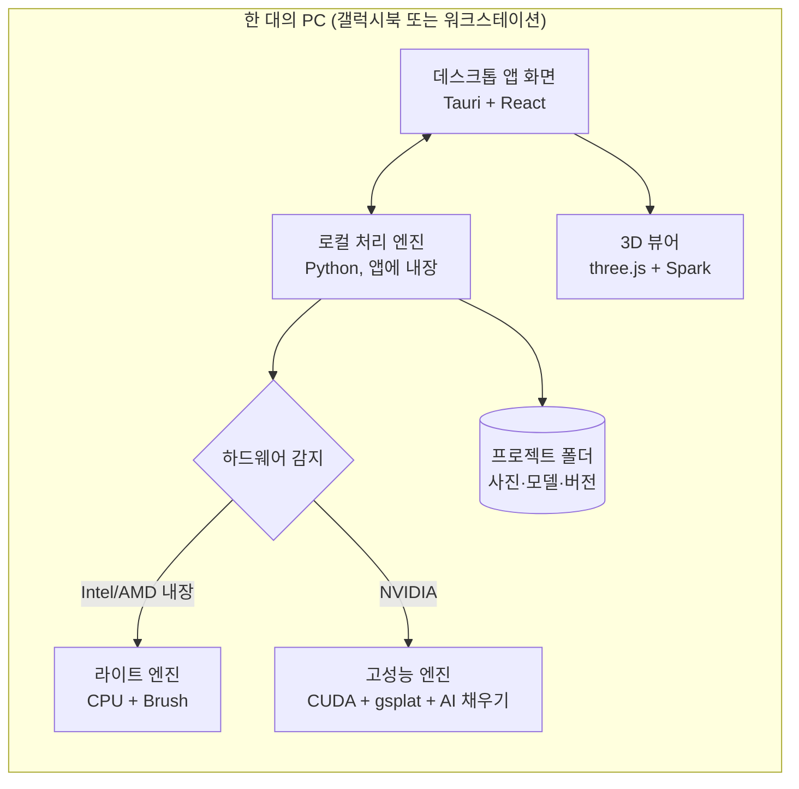
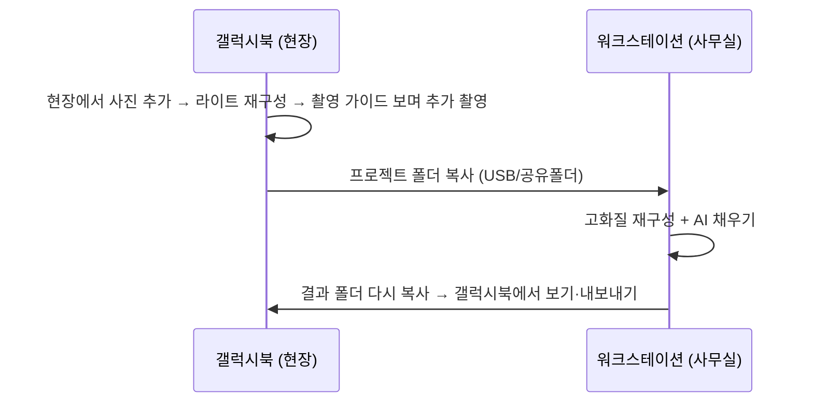
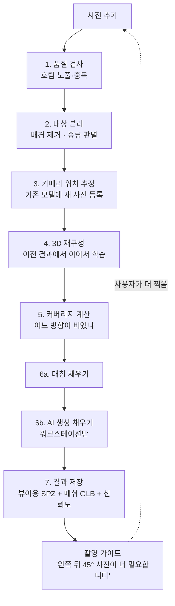

# 사진 → 3D 점진 재구성 툴 설계 문서 (v0.2)

> 여러 각도에서 찍은 사진을 넣으면 3D 모델을 만들어 주는 사내용 **오프라인 데스크톱 툴**.
> 사진이 다 모이지 않아도 **모인 만큼 먼저 재구성**하고, 빈 곳은 **대칭 → AI 생성** 순으로 추정해서 채운다.
> 1차 대상은 자동차, 이후 사람·일반 사물로 넓힌다.
>
> **기준 PC는 갤럭시북**(내장그래픽)이고, 같은 프로그램을 **오프라인으로 설치하면 워크스테이션(NVIDIA GPU)에서도** 더 빠르고 더 많은 기능으로 동작한다.

### 변경 이력
- v0.2: 서버 방식 → **완전 오프라인 단독 실행** 방식으로 변경. 갤럭시북 기준 사양, 하드웨어 자동 감지, 워크스테이션 확장팩 추가.
- v0.1: 최초 작성 (데스크톱 앱 + GPU 서버 구조)

---

## 1. 확정된 요구사항

| 항목 | 결정 |
|---|---|
| 형태 | Windows 데스크톱 앱, **인터넷 없이 설치·실행** |
| 기준 PC | **갤럭시북** (Intel 내장그래픽) — 느려도 전 과정(AI 채우기 제외)이 돌아가야 함 |
| 상위 PC | **워크스테이션** (NVIDIA GPU) — 같은 설치파일로 설치, 자동으로 빠른 엔진 사용 + AI 채우기 가능 |
| 용도 | 사내 업무용 → **상업 사용 가능한 라이선스만** 사용 |
| 결과물 | ① 앱 안에서 돌려 보는 3D 뷰어 ② 3D 메쉬 파일(GLB/OBJ) 내보내기 |
| 빈 곳 채우기 | 대칭으로 먼저 채우고(모든 PC), 그래도 빈 곳은 AI 생성으로 채움(워크스테이션). **채운 부분은 반드시 "추정"으로 표시** |
| 1차 범위 | 설계 문서 (이 문서) |

### 1.1 기준 사양 가정 (확인 필요)

| | 갤럭시북 (최소/기준) | 워크스테이션 (권장) |
|---|---|---|
| CPU | Intel Core Ultra (갤럭시북4 Pro / 5 Pro급) | 8코어 이상 |
| RAM | **16GB 이상** (8GB는 지원 안 함) | 32GB 이상 |
| GPU | Intel Arc 내장그래픽 | NVIDIA RTX, **VRAM 16GB 이상** (AI 채우기용) |
| 저장공간 | 여유 30GB | 여유 60GB |
| OS | Windows 11 64bit (x64) | Windows 10/11 64bit |

> ⚠ **갤럭시북4 Edge(스냅드래곤, ARM)** 는 3D 처리 라이브러리 다수가 ARM용 Windows를 지원하지 않아 **대상에서 제외**한다. 실제 사용할 갤럭시북 모델명을 확인해야 한다.

---

## 2. 전체 구조

서버 없이 **한 대의 PC 안에서** 모든 것이 돈다.



- **앱 화면**(Tauri)과 **처리 엔진**(Python)은 같은 PC 안에서 별도 프로세스로 돈다. 화면은 엔진에 `127.0.0.1`(내 PC 안 통신)로만 요청 → 외부 네트워크 사용 없음.
- 처리 엔진은 PyInstaller 등으로 **앱 설치 폴더 안에 통째로 포함**한다. 사용자 PC에 Python 따로 설치할 필요 없음.
- 처리 엔진은 시작할 때 **하드웨어를 감지**해서 엔진 등급을 고른다 (3장).
- 처리 엔진을 별도 프로세스로 두었으므로, 나중에 필요하면 사내 GPU 서버로 떼어내기도 쉽다(지금 범위는 아님).

---

## 3. 하드웨어 등급별 동작

같은 프로그램, 같은 프로젝트 파일. PC 사양에 따라 **엔진과 품질만** 달라진다.

| 단계 | 🟢 라이트 (갤럭시북) | 🔵 고성능 (워크스테이션) |
|---|---|---|
| 사진 품질 검사 | CPU | CPU |
| 대상 분리 (SAM 2) | 작은 모델, ONNX Runtime (CPU / OpenVINO로 내장그래픽 가속) | 큰 모델, CUDA |
| 카메라 위치 계산 (COLMAP) | CPU 모드 | CUDA 모드 |
| 3D 재구성 (Gaussian Splatting) | **Brush** (Intel/AMD/NVIDIA 모두 되는 GPU 엔진) | **gsplat** (CUDA) |
| 사진 해상도 | 긴 변 1600px로 축소 | 원본 (최대 긴 변 4000px) |
| 모델 크기 | 가우시안 최대 ~50만 개 | 최대 ~300만 개 |
| 메쉬 추출 | 렌더링 깊이맵 → TSDF (Open3D, CPU) | 2DGS(gsplat) 또는 TSDF |
| 대칭 채우기 | ✅ | ✅ |
| AI 생성 채우기 | ❌ (메뉴 비활성 + "워크스테이션에서 가능" 안내) | ✅ TRELLIS |

### 3.1 예상 처리 시간 (사진 30~40장, 대략치 — PoC에서 실측 후 갱신)

| | 갤럭시북 | 워크스테이션 (RTX 4090급) |
|---|---|---|
| 첫 버전 (사진 30장) | 1 ~ 3시간 | 10 ~ 20분 |
| 사진 10장 추가 후 다음 버전 | 30분 ~ 1시간 | 5분 내외 |
| AI 채우기 | — | +5 ~ 10분 |

> 위 수치는 실측이 아닌 추정이며 사양에 따라 몇 배까지 차이 날 수 있다. **PoC 0단계의 핵심 목적이 갤럭시북 실측**이다.

### 3.2 갤럭시북 ↔ 워크스테이션 오가며 쓰기

프로젝트는 **폴더 하나**(`*.p3d`)로 저장되므로 USB/공유폴더로 옮길 수 있다.



- 워크스테이션에서 만든 버전도 갤럭시북 뷰어에서 열린다 (뷰어용 경량 파일을 항상 같이 저장, 4.1 참고).
- 각 버전에 "어느 등급 엔진으로 만들었는지" 기록.

---

## 4. 핵심 아이디어: 점진 재구성

사진을 한 번에 다 받는 게 아니라, **사진이 추가될 때마다 모델 버전을 올린다.**



### 단계별 상세

**1. 품질 검사** (CPU, 수 초)
- 흐림: 라플라시안 분산 기준 미달 → 경고
- 노출 과다/부족, 거의 같은 사진(중복) 제거
- EXIF에서 초점거리·기종 추출 → 카메라 보정 초기값

**2. 대상 분리** — SAM 2 (Apache-2.0)
- 사진에서 대상만 마스크로 분리 → 배경이 재구성을 방해하지 않게 함
- 대상 종류 판별(자동차 / 사람 / 기타) → 이후 단계의 전략 선택에 사용
- 첫 사진에서 사용자가 대상을 한 번 클릭하면 나머지 사진은 자동 추적
- 갤럭시북: ONNX로 변환한 작은 모델 + OpenVINO(Intel 가속)로 장당 수 초 목표

**3. 카메라 위치 추정** — COLMAP / GLOMAP (BSD)
- 사진끼리 특징점 매칭으로 각 사진의 촬영 위치·방향 계산
- 새 사진이 오면 전체를 다시 계산하지 않고 **기존 모델에 등록(register)** 만 한다 → 빠름
- 자동차는 반사·유리·무늬 없는 도장면 때문에 특징점이 적다 → 촬영 가이드로 겹침을 충분히 확보
- 등록 실패한 사진은 "위치를 못 찾음 — 이전 사진과 더 겹치게 찍어주세요"로 안내

**4. 3D 재구성** — Gaussian Splatting
- 라이트: **Brush** (Rust + WebGPU 기반, Intel 내장그래픽에서도 학습 가능)
- 고성능: **gsplat** (CUDA)
- 두 엔진 모두 표준 PLY로 입출력 → 버전 간·엔진 간 호환
- 새 사진이 오면 **이전 결과에서 이어서 학습**(처음부터 X) → 버전업 시간 단축
- 대상 마스크를 학습에 사용 → 배경 없는 깔끔한 모델
- 메쉬: 학습된 모델로 여러 방향 깊이맵을 렌더링 → TSDF 융합(Open3D, MIT) → 메쉬 + 텍스처 → **GLB**

**5. 커버리지 계산**
- 대상 중심의 가상 구(球)를 방향별로 나누고, 각 방향을 몇 장의 사진이 봤는지 계산
- 표면 단위로도 "실측 / 미관측" 판정 → 6단계의 채우기 대상이 됨
- 앱에 **커버리지 구** 위젯으로 표시 (초록 = 충분, 노랑 = 부족, 회색 = 없음)

**6a. 대칭 채우기** (모든 PC, 확실한 것만)
- 대상의 대칭면을 자동 추정 (자동차: 좌우 대칭)
- 한쪽만 찍힌 부분을 반대편으로 복사
- 대칭이 맞는지 검증: 양쪽 다 찍힌 영역에서 비교 → 오차 크면 적용 안 함
- 사람은 자세 때문에 대칭이 깨지므로 **기본적으로 끔** (강체 사물/자동차만)

**6b. AI 생성 채우기** (워크스테이션만)
- **이미지→3D 생성 모델** (TRELLIS, MIT): 가장 잘 나온 사진들로 전체 형상을 생성 → 실측 모델에 크기·위치 맞춤(정합) → **실측이 없는 영역에만** 생성 결과 사용
- NVIDIA VRAM 16GB 이상 필요 → 감지 안 되면 메뉴 비활성
- 사람: 인체 모델 피팅으로 형상 보완 가능하나 SMPL 계열은 상업 라이선스 별도 → 로드맵 4단계에서 검토

**7. 결과 저장 — 신뢰도 레이어**
모든 점(가우시안)·메쉬 정점에 출처 태그를 단다.

| 태그 | 의미 | 뷰어 표시 |
|---|---|---|
| `observed` | 사진으로 실제 확인됨 | 원래 색 |
| `symmetric` | 대칭으로 복사됨 | 파란 반투명 오버레이 |
| `generated` | AI가 추정함 | 주황 반투명 오버레이 |

> **업무용이므로 중요**: 차량 상태 기록 등에 쓰일 경우, AI가 상상한 부분이 실제처럼 보이면 문제가 된다.
> 뷰어 기본값은 "추정 영역 표시 ON", 내보내기 파일에도 태그를 메타데이터로 포함한다.

### 4.1 오래 걸리는 작업 대책 (갤럭시북)

- **중간 저장(체크포인트)**: 몇 분마다 학습 상태 저장 → 노트북을 닫거나 전원이 꺼져도 **이어서 진행**
- **절전 방지**: 처리 중에는 Windows 절전 진입 차단, 배터리 모드면 "전원 연결 권장" 경고
- **미리보기 먼저**: 저해상도로 빠르게(10~20분) 대략적인 결과를 먼저 보여주고, 이후 백그라운드에서 품질 향상
- **처리 우선순위 낮춤**: 처리 중에도 다른 업무 가능하도록 낮은 우선순위로 실행, "성능 우선/조용히" 모드 선택
- **사진 묶어서 처리**: 여러 장을 연속으로 넣으면 몇 초 기다렸다가 한 번에 처리

---

## 5. 데스크톱 앱

### 5.1 기술 선택

| 항목 | 선택 | 이유 |
|---|---|---|
| 앱 프레임워크 | **Tauri 2** + React + TypeScript | 설치파일 작음, Windows 기본 WebView2 사용 |
| 처리 엔진 | Python 3.11 + PyInstaller로 묶어서 내장 | 3D/AI 라이브러리가 대부분 Python |
| 3D 뷰어 | three.js + **Spark** (MIT, Gaussian Splat 렌더러) | 내장그래픽에서도 동작 |
| 뷰어용 포맷 | **SPZ** (압축 스플랫, PLY 대비 ~1/10) / GLB | 로딩 빠름 |
| 로컬 작업 관리 | SQLite | 작업 대기열·진행 상태·재개 정보 |

갤럭시북 뷰어 대응:
- 모든 버전에 **경량 뷰어 파일**(가우시안 수 제한)을 함께 저장해 기본으로 표시
- "고화질 보기"는 선택 시에만 원본 로드
- 메쉬(GLB) 모드는 어떤 PC에서도 가볍게 동작

### 5.2 화면 구성

```
┌────────────────────────────────────────────────────────────┐
│ 프로젝트: 쏘나타_12가3456      [사진 추가] [내보내기 ▼]       │
├──────────────┬─────────────────────────────┬───────────────┤
│ 사진 목록     │                             │ 커버리지       │
│ ✔ IMG_001    │                             │   (구 위젯)    │
│ ✔ IMG_002    │      3D 뷰어                 │  ●●●○○        │
│ ⚠ IMG_003    │   (드래그로 회전/확대)        │               │
│   흐림        │                             │ 촬영 가이드    │
│ ✖ IMG_004    │                             │ · 왼쪽 뒤 45°  │
│   위치 실패    │                             │ · 지붕 위쪽    │
│              │                             │               │
│              │ [☑ 추정 영역 표시] [스플랫|메쉬] │ 버전: v3 ▼    │
├──────────────┴─────────────────────────────┴───────────────┤
│ 🟢 라이트 엔진 · 처리 중: v4 ████████░░ 78% (약 25분 남음) [일시정지] │
└────────────────────────────────────────────────────────────┘
```

주요 기능:
- 사진 드래그앤드롭 → 자동 처리
- 하단에 현재 엔진 등급(🟢 라이트 / 🔵 고성능) 표시, 일시정지/재개
- 버전 히스토리: v1(사진 8장) → v2(15장) → v3(24장) 비교
- 내보내기: GLB, OBJ, PLY(스플랫), SPZ / "실측 영역만" 옵션
- 개인정보: 번호판·얼굴 자동 블러 옵션

---

## 6. 오프라인 설치·배포

### 6.1 설치 패키지 구성

| 패키지 | 내용 | 대략 크기 | 설치 대상 |
|---|---|---|---|
| **기본 설치파일** `Photo3D-Setup.exe` | 앱, 처리 엔진(CPU/Brush), SAM 2 작은 모델, COLMAP(CPU+CUDA 빌드), VC++ 런타임, WebView2 오프라인 설치본 | 1 ~ 2GB | 모든 PC |
| **워크스테이션 확장팩** `Photo3D-GPU-Pack.exe` | CUDA 버전 PyTorch, gsplat, SAM 2 큰 모델, TRELLIS 가중치 | 10 ~ 15GB | NVIDIA PC만 |

- 둘 다 **인터넷 연결 없이** USB·사내 공유폴더로 배포·설치 가능. 실행 중에도 외부 접속 없음(업데이트 확인·사용 통계 전송 없음).
- 모델 가중치는 모두 설치파일에 포함 → 첫 실행 시 다운로드 없음.
- 확장팩 설치 시 NVIDIA 드라이버 버전 확인 (드라이버 자체는 IT팀이 별도 설치).
- 확장팩이 없거나 NVIDIA GPU가 없으면 자동으로 라이트 엔진으로 동작.
- 업데이트: 새 설치파일을 덮어 설치. 프로젝트 폴더 형식은 버전 번호로 하위 호환 유지.

### 6.2 사내 배포 시 고려

- 설치파일 **코드 서명** (서명 없으면 Windows SmartScreen/사내 보안 솔루션이 차단할 수 있음)
- 관리자 권한 없이 사용자 폴더 설치 옵션 제공 (IT 정책에 따라)
- 사내 백신이 처리 엔진(PyInstaller 실행파일)을 오탐할 수 있음 → IT팀 예외 등록 절차 안내 문서 동봉

---

## 7. 데이터 구조

```
쏘나타_12가3456.p3d/
  project.json            # 이름, 대상 종류, 생성일, 설정, 폴더 형식 버전
  photos/                 # 원본 (해시 파일명, 중복 방지)
  masks/                  # 대상 분리 결과
  jobs.sqlite             # 작업 대기열·체크포인트 정보
  versions/
    v001/
      meta.json           # 사용 사진, 엔진 등급(lite/gpu), 처리 시간, 실패 사진
      cameras.json        # 각 사진의 추정 위치·방향
      splat_full.ply      # 원본 가우시안
      splat_lite.spz      # 뷰어용 경량 (항상 생성)
      mesh.glb            # 메쉬
      confidence.bin      # 점/정점별 출처 태그
      coverage.json       # 방향별 커버리지, 촬영 가이드
    v002/ ...
```

로컬 엔진 API (앱 화면 ↔ 처리 엔진, `127.0.0.1` 전용):

| 메서드 | 경로 | 설명 |
|---|---|---|
| GET | `/system` | 감지된 하드웨어·엔진 등급·확장팩 설치 여부 |
| POST | `/projects` | 프로젝트 생성/열기 |
| POST | `/projects/{id}/photos` | 사진 추가 (여러 장) |
| DELETE | `/projects/{id}/photos/{pid}` | 잘못 넣은 사진 제외 후 재처리 |
| GET | `/projects/{id}/status` | 처리 상태·진행률·남은 시간 |
| POST | `/projects/{id}/jobs/{jid}/pause` · `/resume` | 일시정지·재개 |
| GET | `/projects/{id}/versions` | 버전 목록 |

---

## 8. 대상별 전략

| | 자동차 (1순위) | 사람 | 일반 사물 |
|---|---|---|---|
| 어려운 점 | 반사 도장면, 유리, 큰 크기 | **움직임**(촬영 중 자세 변화), 머리카락 | 다양함 |
| 촬영 권장 | 흐린 날/그늘, 차 주위 2바퀴(눈높이 + 높게), 장당 60~70% 겹침, 24~48장 | 짧은 시간 안에 촬영, 가만히 서 있기. 동영상 입력이 유리 | 회전판 위 or 주위 1~2바퀴 |
| 대칭 | 좌우 대칭 ON | OFF | 자동 판정 |
| AI 채우기 (워크스테이션) | 차체 하부·지붕 등 | 뒷모습 등 | 바닥면 등 |
| 메모 | 유리는 품질 한계 있음 → 추정 표시 권장 | 4단계 이후 지원 | 4단계 이후 |

---

## 9. 라이선스 (사내 업무용 = 상업적 사용)

> 아래는 2026년 10월 기준 파악한 내용이며, **도입 직전 각 저장소의 LICENSE를 다시 확인**해야 한다.
> 오프라인 설치파일에 포함해 사내 PC에 배포하는 것도 "재배포"에 해당할 수 있으므로 각 라이선스 고지문을 설치파일에 동봉한다.

| 구성요소 | 라이선스 | 사용 |
|---|---|---|
| COLMAP / GLOMAP | BSD | ✅ |
| gsplat | Apache-2.0 | ✅ |
| Brush | Apache-2.0 (확인 필요) | ✅ |
| SAM 2 | Apache-2.0 | ✅ |
| TRELLIS | MIT | ✅ |
| Open3D | MIT | ✅ |
| ONNX Runtime, OpenVINO | MIT / Apache-2.0 | ✅ |
| Spark, three.js, Tauri | MIT 등 | ✅ |
| PyTorch | BSD 계열 | ✅ |
| NVIDIA CUDA 런타임 | NVIDIA EULA (재배포 허용 범위 내에서 포함) | ⚠ 포함 파일 확인 |
| Inria 원본 3D Gaussian Splatting 코드 | 비상업 전용 | ❌ (gsplat/Brush로 대체) |
| DUSt3R / MASt3R | CC BY-NC-SA (비상업) | ❌ |
| VGGT | 기본 가중치는 비상업, 상업용 가중치 별도(확인 필요) | ⚠ |
| Hunyuan3D 2.x | 텐센트 커뮤니티 라이선스 — **한국은 사용 지역에서 제외** | ❌ |
| OpenMVS, OpenSplat | AGPL-3.0 | ⚠ 사용 안 함 (Open3D TSDF로 대체) |
| SMPL / SMPL-X (인체 모델) | 비상업, 상업은 별도 계약 | ⚠ 사람 지원 시 검토 |

---

## 10. 개발 로드맵

| 단계 | 내용 | 완료 기준 |
|---|---|---|
| **0. PoC** (1~2주) | 스크립트로 자동차 사진 → COLMAP → Brush/gsplat → 뷰어. **갤럭시북과 워크스테이션 양쪽에서 실측** | 사내 차량 사진 30장으로 갤럭시북에서 3시간 이내에 볼 만한 결과 |
| **1. MVP** (4~6주) | Tauri 앱 + 내장 처리 엔진, 하드웨어 감지·엔진 선택, **점진 등록**, 체크포인트·재개, 커버리지·촬영 가이드, GLB 내보내기, 기본 오프라인 설치파일 | 인터넷 끊긴 갤럭시북에 설치 후, 사진을 10장씩 3번 나눠 넣어도 v1→v3로 개선됨 |
| **2. 대칭 채우기** (1~2주) | 대칭면 추정·검증·복사, 신뢰도 레이어·오버레이 | 한쪽 면만 찍은 차량이 양쪽 다 보임(파란 표시) |
| **3. AI 채우기 + 확장팩** (3~4주) | TRELLIS 생성 + 정합, 미관측 영역만 대체, 워크스테이션 확장팩 설치파일 | 워크스테이션에서 지붕/뒤쪽 미촬영 상태에서 형상 채워짐(주황 표시), 그 결과를 갤럭시북에서 열람 |
| **4. 대상 확장** | 사람(동영상 입력, 움직임 대응), 일반 사물 | 대상별 품질 기준 통과 |

각 단계 기간은 개발자 1명 기준 대략치.

---

## 11. 주요 위험과 대응

| 위험 | 대응 |
|---|---|
| 갤럭시북에서 너무 느려 실사용 불가 | PoC에서 먼저 실측. 미리보기 우선 표시, 해상도·모델 크기 조절. 그래도 부족하면 "현장은 촬영·미리보기, 본 처리는 워크스테이션" 운영으로 전환 |
| 16GB RAM 부족 | 사진 해상도 자동 축소, 단계별 메모리 해제, 처리 시작 전 여유 메모리 확인 |
| 노트북 발열·배터리 | 체크포인트·재개, 절전 방지, 전원 연결 권장, "조용히" 모드 |
| 자동차 반사·유리로 품질 저하 | 촬영 가이드(흐린 날·그늘), 마스크 사용, 유리 영역은 추정 처리 |
| AI 추정이 실물처럼 오해됨 | 신뢰도 레이어, 기본 표시 ON, 내보내기 메타데이터 |
| 사내 보안 솔루션이 설치·실행 차단 | 코드 서명, IT팀 예외 등록 안내, 외부 통신 없음을 명시 |
| 설치파일 용량 | 기본/확장팩 분리, 확장팩은 워크스테이션에만 |

---

## 12. 다음 결정이 필요한 것들

1. **갤럭시북 정확한 모델과 RAM**: 예) 갤럭시북4 Pro / 16GB. (Edge 모델이면 대상 제외)
2. **워크스테이션 GPU**: NVIDIA 모델과 VRAM 용량. (AI 채우기는 16GB 이상 필요)
3. **사용량**: 한 달에 몇 대 정도 처리? 현장에서 바로 결과를 봐야 하는가, 사무실에서 나중에 봐도 되는가?
4. **정확도 요구**: "보기 좋은 3D"면 충분한가, 실제 치수 측정까지 필요한가?
5. **촬영 방식**: 스마트폰 사진? 동영상도 허용? 촬영 장소(실내/야외)?
6. **설치 정책**: 사내 PC에 관리자 권한으로 설치 가능한가? 코드 서명 인증서가 있는가?
7. **샘플 데이터**: PoC용 실제 차량 사진 세트(30장 내외)를 받을 수 있는가?
