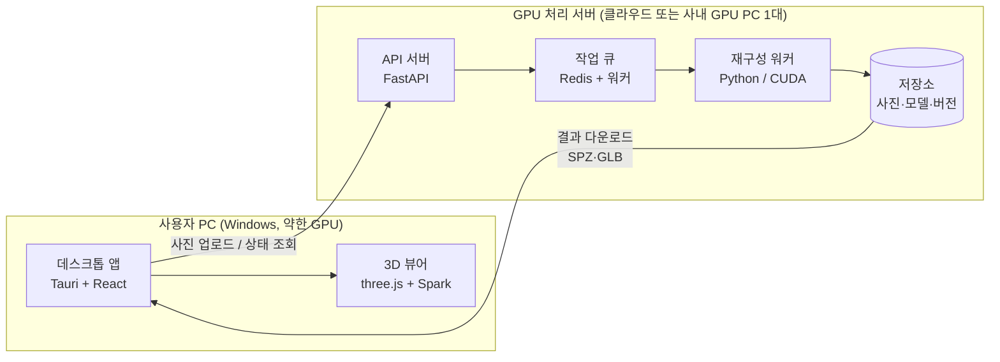
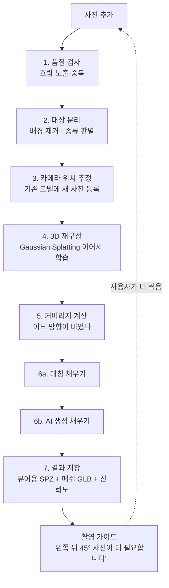

# 사진 → 3D 점진 재구성 툴 설계 문서 (v0.1)

> 여러 각도에서 찍은 사진을 올리면 3D 모델을 만들어 주는 사내용 데스크톱 툴.
> 사진이 다 모이지 않아도 **모인 만큼 먼저 재구성**하고, 빈 곳은 **대칭 → AI 생성** 순으로 추정해서 채운다.
> 1차 대상은 자동차, 이후 사람·일반 사물로 넓힌다.

---

## 1. 확정된 요구사항

| 항목 | 결정 |
|---|---|
| 형태 | Windows 데스크톱 앱 |
| 사용자 PC | GPU 없거나 약함 → **무거운 연산은 GPU 서버에서**, PC는 업로드·조회·뷰어만 담당 |
| 용도 | 사내 업무용 → **상업 사용 가능한 라이선스만** 사용 |
| 결과물 | ① 앱 안에서 돌려 보는 3D 뷰어 ② 3D 메쉬 파일(GLB/OBJ) 내보내기 |
| 빈 곳 채우기 | 대칭으로 먼저 채우고, 그래도 빈 곳은 AI 생성으로 채움. **채운 부분은 반드시 "추정"으로 표시** |
| 1차 범위 | 설계 문서 (이 문서) |

---

## 2. 전체 구조



- **앱은 얇게**: PC 사양이 약하므로 앱은 사진 관리, 진행 상황, 뷰어, 내보내기만 한다.
- **서버는 하나의 GPU 워커로 시작**: 사용량이 적은 사내 툴이므로 GPU 1장(24GB급, RTX 4090 / L4 / A10G)으로 충분하다.
- 앱과 서버는 HTTP API로만 통신 → 나중에 서버를 클라우드↔사내 서버로 바꿔도 앱은 그대로.

### 2.1 GPU 서버를 어디에 둘지 (결정 필요)

| 선택지 | 장점 | 단점 | 이런 경우 추천 |
|---|---|---|---|
| **A. 클라우드 GPU 온디맨드** (RunPod, AWS g5/g6 등) | 초기 비용 0, 쓸 때만 과금 | 사진이 회사 밖으로 나감, 서버 기동 대기(1~3분) | PoC 단계, 사용량이 들쑥날쑥할 때 |
| **B. 사내 GPU PC 1대** (RTX 4090급 워크스테이션) | 사진이 사내에 머묾, 대기 없음, 장기적으로 저렴 | 초기 구매비, 관리 필요 | 사진 보안이 중요하거나 매일 쓰는 경우 |

**추천: PoC는 A로 빠르게 검증 → 실사용이 확정되면 B로 이전.** 앱은 서버 주소만 바꾸면 된다.

---

## 3. 핵심 아이디어: 점진 재구성

사진을 한 번에 다 받는 게 아니라, **사진이 추가될 때마다 모델 버전을 올린다.**



### 단계별 상세

**1. 품질 검사** (CPU, 수 초)
- 흐림: 라플라시안 분산 기준 미달 → 경고
- 노출 과다/부족, 거의 같은 사진(중복) 제거
- EXIF에서 초점거리·기종 추출 → 카메라 보정 초기값

**2. 대상 분리** — SAM 2 (Apache-2.0)
- 사진에서 대상만 마스크로 분리 → 배경이 재구성을 방해하지 않게 함
- 대상 종류 판별(자동차 / 사람 / 기타) → 이후 단계의 전략 선택에 사용
- 첫 사진에서 사용자가 대상을 한 번 클릭하면 나머지 사진은 자동 추적

**3. 카메라 위치 추정**
- 기본: **COLMAP / GLOMAP** (BSD) — 사진끼리 특징점 매칭으로 각 사진의 촬영 위치·방향 계산
- 새 사진이 오면 전체를 다시 계산하지 않고 **기존 모델에 등록(register)** 만 한다 → 빠름
- 자동차는 반사·유리·무늬 없는 도장면 때문에 특징점이 적다 → 사진 수가 적을 때는 **학습 기반 포즈 추정 모델**로 보완 (라이선스 확인 필요, 7장 참고)
- 등록 실패한 사진은 "위치를 못 찾음 — 이전 사진과 더 겹치게 찍어주세요"로 안내

**4. 3D 재구성** — **gsplat** (Apache-2.0) 기반 Gaussian Splatting
- 사진처럼 사실적인 결과, 학습 속도 빠름(1~10분)
- 새 사진이 오면 **이전 결과에서 이어서 학습**(처음부터 X) → 버전업 시간 단축
- 대상 마스크를 학습에 사용 → 배경 없는 깔끔한 모델
- 메쉬 추출: 2D Gaussian Splatting 계열 또는 렌더링된 깊이맵으로 TSDF 융합 → 메쉬 + 텍스처 → **GLB**

**5. 커버리지 계산**
- 대상 중심의 가상 구(球)를 방향별로 나누고, 각 방향을 몇 장의 사진이 봤는지 계산
- 표면 단위로도 "실측 / 미관측" 판정 → 6단계의 채우기 대상이 됨
- 앱에 **커버리지 구** 위젯으로 표시 (초록 = 충분, 노랑 = 부족, 회색 = 없음)

**6a. 대칭 채우기** (확실한 것만)
- 대상의 대칭면을 자동 추정 (자동차: 좌우 대칭)
- 한쪽만 찍힌 부분을 반대편으로 복사
- 대칭이 맞는지 검증: 양쪽 다 찍힌 영역에서 비교 → 오차 크면 적용 안 함
- 사람은 자세 때문에 대칭이 깨지므로 **기본적으로 끔** (강체 사물/자동차만)

**6b. AI 생성 채우기** (그래도 빈 곳)
- 방법 1 — **이미지→3D 생성 모델** (예: TRELLIS, MIT): 가장 잘 나온 사진들로 전체 형상을 생성 → 실측 모델에 크기·위치 맞춤(정합) → **실측이 없는 영역에만** 생성 결과 사용
- 방법 2 — **새 시점 이미지 생성**: 빈 방향의 가짜 사진을 생성해 학습에 낮은 가중치로 투입
- PoC에서 두 방법을 비교 후 하나 선택 (방법 1이 구현 단순, 추천)
- 사람: 인체 모델 피팅으로 형상 보완 가능하나 SMPL 계열은 상업 라이선스 별도 → 4단계(로드맵)에서 검토

**7. 결과 저장 — 신뢰도 레이어**
모든 점(가우시안)·메쉬 정점에 출처 태그를 단다.

| 태그 | 의미 | 뷰어 표시 |
|---|---|---|
| `observed` | 사진으로 실제 확인됨 | 원래 색 |
| `symmetric` | 대칭으로 복사됨 | 파란 반투명 오버레이 |
| `generated` | AI가 추정함 | 주황 반투명 오버레이 |

> **업무용이므로 중요**: 차량 상태 기록 등에 쓰일 경우, AI가 상상한 부분이 실제처럼 보이면 문제가 된다.
> 뷰어 기본값은 "추정 영역 표시 ON", 내보내기 파일에도 태그를 메타데이터로 포함한다.

---

## 4. 데스크톱 앱

### 4.1 기술 선택

| 항목 | 선택 | 이유 |
|---|---|---|
| 앱 프레임워크 | **Tauri 2** + React + TypeScript | 설치파일 작음(~10MB), Windows 기본 WebView2 사용 |
| 3D 뷰어 | three.js + **Spark** (MIT, Gaussian Splat 렌더러) | 내장 그래픽에서도 동작, 웹 기술이라 개발 쉬움 |
| 전송 포맷 | **SPZ** (압축 스플랫, PLY 대비 ~1/10) / GLB | 다운로드·로딩 빠름 |

약한 GPU 대응:
- 서버에서 **경량 버전**(가우시안 수 제한, 예: 50만 개)을 따로 만들어 기본으로 표시
- "고화질 보기"는 선택 시에만 원본 로드
- 메쉬(GLB) 모드는 어떤 PC에서도 가볍게 동작

### 4.2 화면 구성

```
┌────────────────────────────────────────────────────────────┐
│ 프로젝트: 쏘나타_12가3456      [사진 추가] [내보내기 ▼]       │
├──────────────┬─────────────────────────────┬───────────────┤
│ 사진 목록     │                             │ 커버리지       │
│ ✔ IMG_001    │                             │   (구 위젯)    │
│ ✔ IMG_002    │      3D 뷰어                 │  ●●●○○        │
│ ⚠ IMG_003    │   (드래그로 회전/확대)        │               │
│   흐림        │                             │ 촬영 가이드    │
│ ✖ IMG_004    │                             │ · 왼쪽 뒤 45°  │
│   위치 실패    │                             │ · 지붕 위쪽    │
│              │                             │               │
│              │ [☑ 추정 영역 표시] [스플랫|메쉬] │ 버전: v3 ▼    │
├──────────────┴─────────────────────────────┴───────────────┤
│ 처리 중: v4 재구성 ████████░░ 78% (약 2분 남음)               │
└────────────────────────────────────────────────────────────┘
```

주요 기능:
- 사진 드래그앤드롭 → 자동 업로드 → 자동 처리 (여러 장 연속으로 넣으면 몇 초 모아서 한 번에 처리)
- 버전 히스토리: v1(사진 8장) → v2(15장) → v3(24장) 비교
- 내보내기: GLB, OBJ, PLY(스플랫), SPZ / "실측 영역만" 옵션
- 개인정보: 번호판·얼굴 자동 블러 옵션

---

## 5. 데이터 구조

```
project/
  project.json            # 이름, 대상 종류, 생성일, 설정
  photos/                 # 원본 (해시 파일명, 중복 방지)
  masks/                  # 대상 분리 결과
  versions/
    v001/
      cameras.json        # 각 사진의 추정 위치·방향
      splat_full.ply      # 원본 가우시안
      splat_lite.spz      # 뷰어용 경량
      mesh.glb            # 메쉬
      confidence.bin      # 점/정점별 출처 태그
      coverage.json       # 방향별 커버리지, 촬영 가이드
      report.json         # 사용 사진, 실패 사진, 처리 시간
    v002/ ...
```

API (초안):

| 메서드 | 경로 | 설명 |
|---|---|---|
| POST | `/projects` | 프로젝트 생성 |
| POST | `/projects/{id}/photos` | 사진 업로드 (여러 장) |
| GET | `/projects/{id}/status` | 처리 상태·진행률 |
| GET | `/projects/{id}/versions` | 버전 목록 |
| GET | `/projects/{id}/versions/{v}/{file}` | 결과 파일 다운로드 |
| DELETE | `/projects/{id}/photos/{pid}` | 잘못 올린 사진 제외 후 재처리 |

---

## 6. 대상별 전략

| | 자동차 (1순위) | 사람 | 일반 사물 |
|---|---|---|---|
| 어려운 점 | 반사 도장면, 유리, 큰 크기 | **움직임**(촬영 중 자세 변화), 머리카락 | 다양함 |
| 촬영 권장 | 흐린 날/그늘, 차 주위 2바퀴(눈높이 + 높게), 장당 60~70% 겹침, 24~48장 | 짧은 시간 안에 촬영, 가만히 서 있기. 동영상 입력이 유리 | 회전판 위 or 주위 1~2바퀴 |
| 대칭 | 좌우 대칭 ON | OFF | 자동 판정 |
| AI 채우기 | 차체 하부·지붕 등 | 뒷모습 등 | 바닥면 등 |
| 메모 | 유리는 품질 한계 있음 → 추정 표시 권장 | 2단계 이후 지원 | 3단계 이후 |

---

## 7. 라이선스 (사내 업무용 = 상업적 사용)

> 아래는 2026년 10월 기준 파악한 내용이며, **도입 직전 각 저장소의 LICENSE를 다시 확인**해야 한다.

| 구성요소 | 라이선스 | 사용 |
|---|---|---|
| COLMAP / GLOMAP | BSD | ✅ |
| gsplat, Nerfstudio | Apache-2.0 | ✅ |
| SAM 2 | Apache-2.0 | ✅ |
| TRELLIS | MIT | ✅ |
| Spark, three.js, Tauri | MIT 등 | ✅ |
| Inria 원본 3D Gaussian Splatting 코드 | 비상업 전용 | ❌ (gsplat으로 대체) |
| DUSt3R / MASt3R | CC BY-NC-SA (비상업) | ❌ |
| VGGT | 기본 가중치는 비상업, 상업용 가중치 별도 신청 필요(확인 필요) | ⚠ |
| Hunyuan3D 2.x | 텐센트 커뮤니티 라이선스 — **한국은 사용 지역에서 제외**됨 | ❌ |
| Stable Fast 3D 등 Stability 모델 | 커뮤니티 라이선스(연매출 기준 조건) | ⚠ 회사 규모 확인 |
| SMPL / SMPL-X (인체 모델) | 비상업, 상업은 별도 계약 | ⚠ 사람 지원 시 검토 |

---

## 8. 개발 로드맵

| 단계 | 내용 | 완료 기준 |
|---|---|---|
| **0. PoC** (1~2주) | GPU 서버에서 스크립트로: 자동차 사진 → COLMAP → gsplat → 웹 뷰어 확인 | 실제 사내 차량 사진 30장으로 볼 만한 결과 |
| **1. MVP** (3~5주) | 서버 API + 작업 큐, Tauri 앱(프로젝트·업로드·뷰어·버전), **점진 등록**, 커버리지·촬영 가이드, GLB 내보내기 | 사진을 10장씩 3번 나눠 올려도 v1→v3로 개선됨 |
| **2. 대칭 채우기** (1~2주) | 대칭면 추정·검증·복사, 신뢰도 레이어·오버레이 | 한쪽 면만 찍은 차량이 양쪽 다 보임(파란 표시) |
| **3. AI 채우기** (2~4주) | 이미지→3D 생성 + 정합, 미관측 영역만 대체 | 지붕/뒤쪽 미촬영 상태에서 형상 채워짐(주황 표시) |
| **4. 대상 확장** | 사람(동영상 입력, 움직임 대응), 일반 사물 | 대상별 품질 기준 통과 |

각 단계 기간은 개발자 1명 기준 대략치.

---

## 9. 주요 위험과 대응

| 위험 | 대응 |
|---|---|
| 자동차 반사·유리로 재구성 품질 저하 | 촬영 가이드(흐린 날·그늘), 마스크 사용, 유리 영역은 추정 처리 |
| 사진이 적을 때 카메라 위치 추정 실패 | 겹침 부족 안내, 학습 기반 포즈 모델(상업 라이선스 확보 시) |
| AI 추정이 실물처럼 오해됨 | 신뢰도 레이어, 기본 표시 ON, 내보내기 메타데이터 |
| 사진 외부 유출 (클라우드) | 사내 서버 옵션, 전송 TLS, 번호판·얼굴 블러, 처리 후 원본 자동 삭제 옵션 |
| GPU 비용 | 온디맨드 + 유휴 시 자동 종료, 사용량 많으면 사내 GPU PC로 이전 |

---

## 10. 다음 결정이 필요한 것들

1. **GPU 서버 위치**: 클라우드로 PoC 시작해도 되는가? 사진을 외부로 보내도 되는 데이터인가?
2. **사용량**: 하루/한 달에 몇 대 정도 처리할 예정인가? (서버 선택·비용 산정용)
3. **정확도 요구**: "보기 좋은 3D"면 충분한가, 아니면 실제 치수(mm 단위) 측정까지 필요한가?
4. **촬영 방식**: 스마트폰 사진? 동영상도 허용? 촬영 장소(실내 스튜디오/야외 주차장)는?
5. **사용자 규모**: 몇 명이 쓰는가? 로그인·권한 관리가 필요한가?
6. **샘플 데이터**: PoC용 실제 차량 사진 세트(30장 내외)를 받을 수 있는가?
